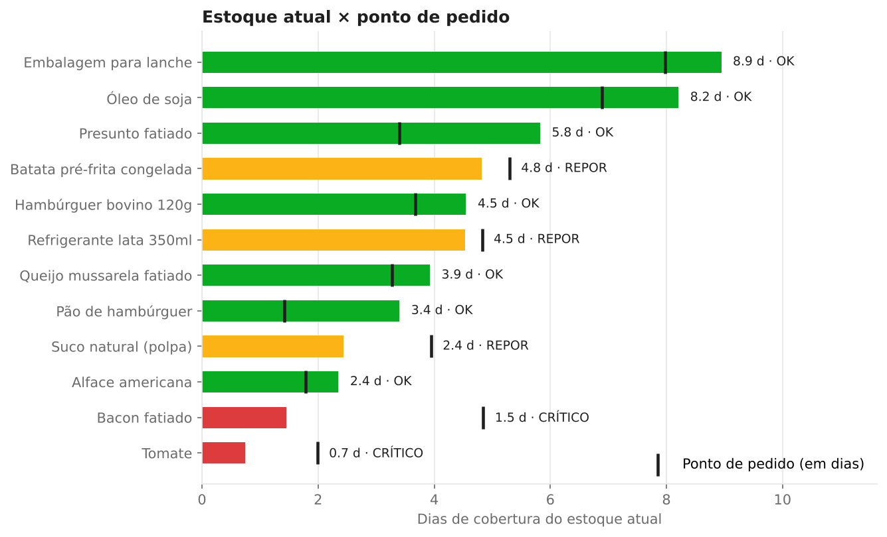
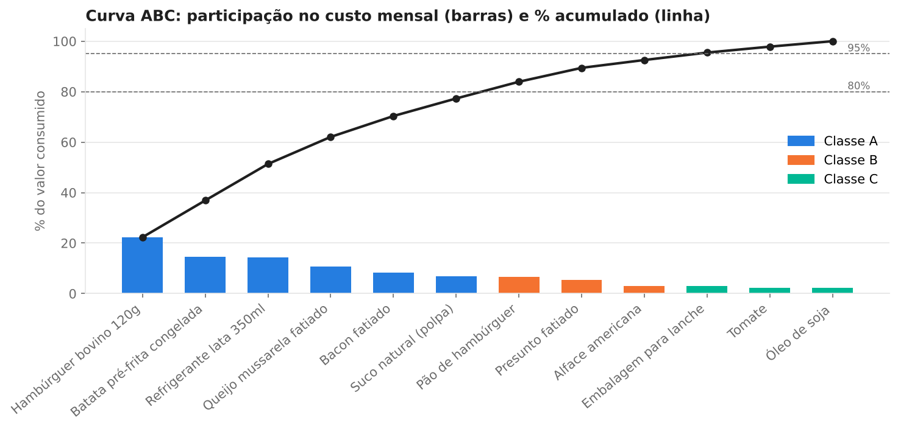
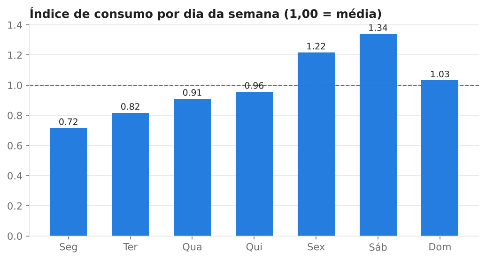
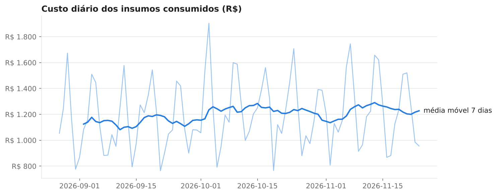

# 🍔 Gestão de Estoque e Estoque de Segurança: Lanchonete

Projeto de Ciência de Dados que calcula **quando** e **quanto** comprar de cada insumo de uma lanchonete, para evitar a falta de produtos (ruptura) sem deixar dinheiro parado em estoque.

> ⚠️ Os dados são **simulados** para fins de estudo, com sazonalidade semanal, tendência e variação aleatória.



## 🎯 Problema de negócio

Uma lanchonete trabalha com insumos perecíveis e prazos de entrega diferentes por fornecedor. Comprar pouco gera ruptura: o cliente pede um X-Bacon e não tem bacon. Comprar demais gera desperdício e capital parado. O objetivo é responder, para cada insumo:

1. Qual estoque mínimo protege contra a variação da demanda? (**estoque de segurança**)
2. Em que momento fazer o pedido? (**ponto de pedido**)
3. Quanto comprar? (**quantidade sugerida**)
4. Quais itens merecem mais atenção? (**curva ABC**)

## 🧮 Metodologia

| Indicador | Fórmula |
|---|---|
| Demanda média diária (d) | média do consumo diário |
| Desvio padrão (σ) | desvio padrão amostral do consumo diário |
| **Estoque de segurança (ES)** | `Z × σ × √LT` |
| **Ponto de pedido (PP)** | `d × LT + ES` |
| Estoque máximo | `PP + d × dias de cobertura` |
| Quantidade sugerida | `estoque máximo − estoque atual` (se estoque ≤ PP) |

- **LT** = lead time, o prazo de entrega do fornecedor em dias.
- **Z** = fator do nível de serviço. Com 95%, Z ≈ 1,645, ou seja, há 95% de chance de não faltar o insumo enquanto o pedido não chega.
- **Status:** 🔴 CRÍTICO (estoque ≤ ES) · 🟡 REPOR (estoque ≤ PP) · 🟢 OK.
- **Curva ABC:** A = até 80% do custo acumulado, B = até 95%, C = restante.

## 📊 Resultados

| Insumo | Demanda/dia | Estoque de segurança | Ponto de pedido | Estoque atual | Status |
|---|---|---|---|---|---|
| Tomate (kg) | 4,0 | 3 | 8 | 3 | 🔴 CRÍTICO |
| Bacon fatiado (kg) | 2,1 | 3 | 10 | 3 | 🔴 CRÍTICO |
| Suco natural (un) | 18,5 | 17 | 73 | 45 | 🟡 REPOR |
| Refrigerante lata (un) | 61,8 | 50 | 298 | 280 | 🟡 REPOR |
| Batata congelada (kg) | 12,5 | 16 | 66 | 60 | 🟡 REPOR |

**Principais insights**

- **2 itens críticos e 3 para repor.** O pedido sugerido custa cerca de **R$ 4.584**.
- **6 dos 12 insumos (classe A) concentram ~77% do custo**, com o hambúrguer bovino sozinho em ~22%. Esses itens pedem controle diário.
- **Sexta e sábado consomem 22% a 34% acima da média**, e a segunda fica 28% abaixo. Pedidos feitos na quinta devem considerar esse pico.
- Itens com **lead time longo** (embalagens, 7 dias; óleo, 5 dias) precisam de estoque de segurança maior, mesmo com demanda estável.

| Curva ABC | Sazonalidade semanal |
|---|---|
|  |  |



## 📁 Estrutura

```
estoque-lanchonete/
├── data/
│   ├── produtos.csv              # cadastro dos insumos
│   ├── vendas_diarias.csv        # consumo diário (90 dias)
│   └── indicadores_estoque.csv   # resultado da análise
├── excel/
│   └── gestao_estoque_lanchonete.xlsx   # planilha com fórmulas e dashboard
├── images/                       # gráficos gerados
├── src/
│   ├── gerar_dados.py            # simulação dos dados
│   ├── analise_estoque.py        # cálculos e gráficos em Python
│   └── criar_planilha.py         # gera a planilha Excel
├── requirements.txt
└── README.md
```

## 📗 Planilha Excel

A planilha funciona sozinha, sem Python, e é recalculada por fórmulas:

- **Parâmetros:** nível de serviço e dias de cobertura (editáveis)
- **Produtos:** custo, lead time e estoque atual
- **Vendas:** consumo diário por insumo
- **Análise:** ES, PP, estoque máximo, status com cores e sugestão de compra
- **Curva ABC** e **Dashboard** com indicadores, lista de compras e gráficos

Funções usadas: `NORMSINV`, `AVERAGE`, `STDEV`, `INDEX/MATCH`, `ROUNDUP`, `SUMIF`, `COUNTIF`, `IFERROR` e formatação condicional.

## ▶️ Como executar

```bash
pip install -r requirements.txt
python src/gerar_dados.py       # gera os dados simulados
python src/analise_estoque.py   # calcula indicadores e gráficos
python src/criar_planilha.py    # gera a planilha Excel
```

## 🚀 Próximos passos

- Prever a demanda com modelos de séries temporais (Prophet, SARIMA ou LightGBM) em vez de usar a média histórica
- Considerar a validade dos perecíveis no cálculo do estoque máximo
- Calcular o lote econômico de compra (EOQ)
- Criar um dashboard interativo em Streamlit ou Power BI

## 🛠️ Tecnologias

Python · Pandas · NumPy · SciPy · Matplotlib · OpenPyXL · Excel

---
Feito por **[Proclise](https://github.com/Proclise)** · [LinkedIn](https://linkedin.com/in/seu-perfil) <!-- troque pelo link do seu LinkedIn -->
